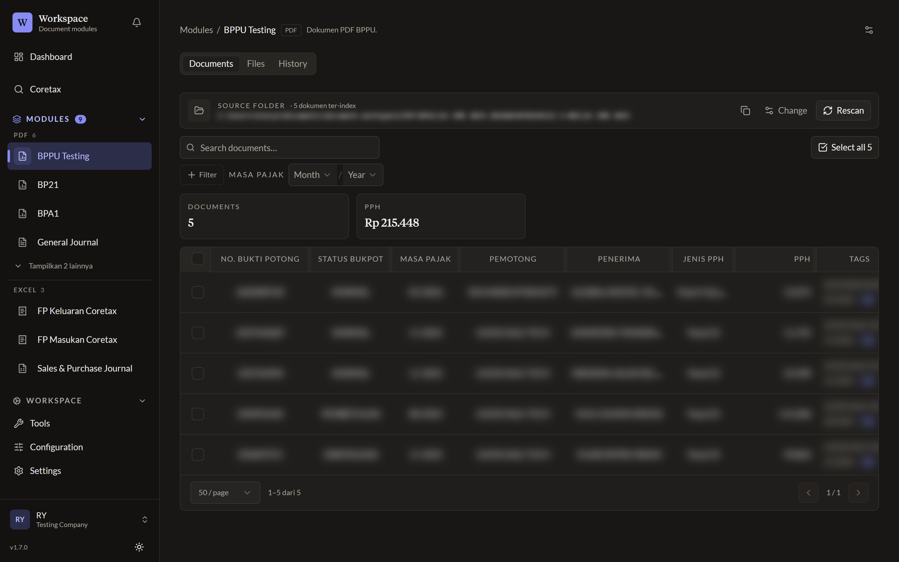
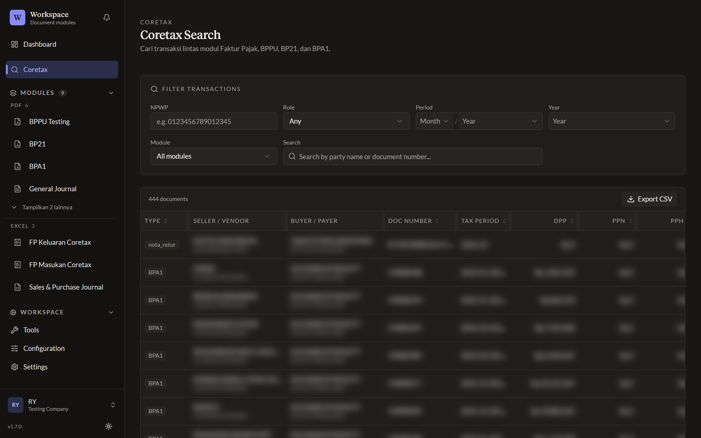

# Document Workspace

Aplikasi desktop Windows untuk mengelola dokumen pajak Coretax (Faktur Pajak, Nota Retur, BPPU, BP21, BPA1) dan file Excel pendukung. Semua data tersimpan di folder lokal Anda.

## Yang bisa dilakukan

- Hubungkan folder Coretax, file langsung di-scan dan diindeks.
- Cari dan filter dokumen berdasarkan masa pajak, status, dan tag.
- Cari transaksi lintas modul berdasarkan NPWP, nama, atau nomor dokumen.
- Rekap ke Excel dan rename file massal.

## Changelog

Catatan tiap versi ada di halaman [Releases](https://github.com/sieryo/document-workspace-releases/releases).
